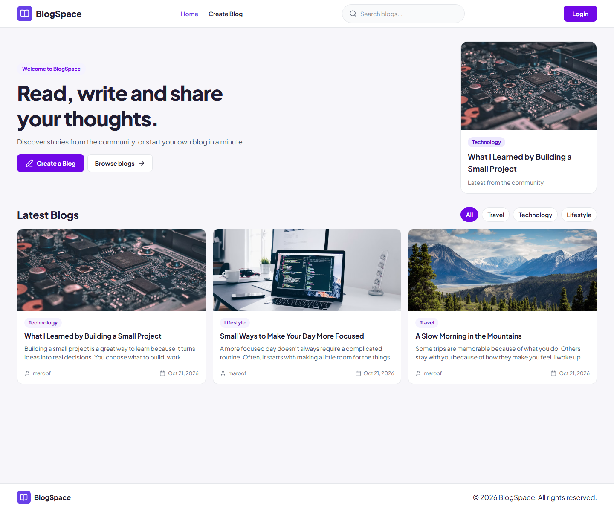
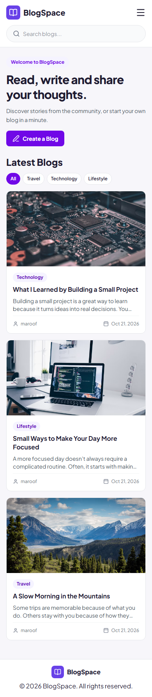

# BlogSpace

A full-stack blogging platform for discovering stories and sharing your own. Browse posts without an account, or sign up to publish and manage your writing.

## Project preview

### Desktop



### Mobile



*Both previews use sample posts to demonstrate the responsive layout.*

## Features

### Discover stories
- Browse the latest public blog posts.
- Search posts by title and filter by Travel, Technology, or Lifestyle.
- Open a post to read its full description, author, date, and cover image.

### Publish and manage posts
- Create an account and sign in to publish stories.
- Add a title, category, description, and optional cover image URL.
- Edit or delete your own posts; ownership is checked by the API.
- View your posts in the **My Blogs** section.

### Designed for everyday use
- Responsive layout for mobile, tablet, and desktop.
- Helpful empty, loading, and error states.
- Image fallback when a post has no cover or its image cannot load.

### Security and reliability
- Passwords are hashed with bcrypt.
- JWT sessions use HTTP-only cookies.
- Login endpoints are rate limited.
- API validates blog input and uses parameterized PostgreSQL queries.
- Health-check endpoint is available at `/api/health`.

## Tech stack

| Area | Technologies |
| --- | --- |
| Frontend | React, Vite, Tailwind CSS, React Router |
| Backend | Node.js, Express |
| Database | PostgreSQL |
| Authentication | JWT, HTTP-only cookies, bcrypt |
| Deployment | Vercel (frontend), Render (API), Neon (PostgreSQL) |

## Project structure

```text
backend/       Express API, authentication, and PostgreSQL access
frontend/      React application, pages, and Vite configuration
render.yaml    Render Blueprint for the API
```

## Table of contents

- [Run locally](#run-locally)
- [Deploy](#deploy)
- [Useful commands](#useful-commands)
- [Security notes](#security-notes)

## Run locally

### Requirements

- Node.js 22.12 or newer (with npm)
- A PostgreSQL database. A Neon database works for local development.

### 1. Configure the API

From the repository root in PowerShell:

```powershell
Copy-Item backend\.env.example backend\.env
```

Edit `backend\.env` and set:

| Variable | Purpose |
| --- | --- |
| `PORT` | API port; defaults to `5000` |
| `NODE_ENV` | Use `development` locally |
| `DATABASE_URL` | PostgreSQL connection string |
| `JWT_SECRET` | A long, random secret used to sign login tokens |

Do not share or commit your `.env` file. `.env` files are ignored by Git.

### 2. Install dependencies

```powershell
npm ci --prefix backend
npm ci --prefix frontend
```

### 3. Start the API and frontend

Open two terminals at the repository root.

In terminal 1:

```powershell
npm run dev --prefix backend
```

In terminal 2:

```powershell
npm run dev --prefix frontend
```

Open the local URL printed by Vite (usually `http://localhost:5173`). The frontend proxies `/api` requests to the local API. On startup, the API creates the required `users` and `blogs` tables if they do not already exist.

## Deploy

The repository is configured for a split deployment: Render runs the API, Vercel serves the frontend, and Neon provides PostgreSQL. Deploy the API first, then the frontend.

### 1. Create the database on Neon

1. Create a PostgreSQL project in [Neon](https://neon.tech/).
2. Copy its connection string. Use the pooled connection string if available.
3. Keep the connection string private; it will be saved as a Render environment variable.

The API creates its tables during startup. No separate migration command is required for the current schema.

### 2. Deploy the API on Render

1. Push this repository to GitHub.
2. In [Render](https://render.com/), select **New + → Blueprint** and connect the repository.
3. Render reads the root `render.yaml`. Confirm the `blogspace-api` web service is created.
4. Set `DATABASE_URL` to the Neon connection string when prompted. The Blueprint generates `JWT_SECRET` and sets `NODE_ENV=production`.
5. Deploy and wait for the service health check to pass.

The Blueprint configures:

| Setting | Value |
| --- | --- |
| Root directory | `backend` |
| Build command | `npm ci --omit=dev` |
| Start command | `npm start` |
| Health check path | `/api/health` |

Copy the public Render service URL. The repository's Vercel rewrite currently targets `https://blogspace-m6gs.onrender.com`; if your Render URL differs, update the destination in `frontend/vercel.json` before deploying the frontend.

### 3. Deploy the frontend on Vercel

1. In [Vercel](https://vercel.com/), create a project and import the same GitHub repository.
2. Set **Root Directory** to `frontend`.
3. Use the Vite framework preset and these settings:

   | Setting | Value |
   | --- | --- |
   | Install command | `npm ci` |
   | Build command | `npm run build` |
   | Output directory | `dist` |

4. Do not add a production API environment variable: the frontend uses `/api`, and `frontend/vercel.json` forwards API requests to Render.
5. Deploy the project.

The Vercel rewrite keeps browser API requests on the frontend's origin, which is also used for authentication cookies.

### 4. Verify the deployment

1. Visit `https://YOUR-RENDER-SERVICE.onrender.com/api/health`. A healthy service responds with `{"status":"ok"}`.
2. Open the Vercel URL and try registering, logging in, creating a post, editing/deleting your own post, and logging out.
3. If something fails, inspect the Render service logs and Vercel deployment logs. Confirm the Render `DATABASE_URL` is correct and that the API URL in `frontend/vercel.json` matches your Render service.

Free hosting plans may pause services when idle, so the first request after inactivity can take longer.

## Useful commands

Run from the repository root:

```powershell
npm run dev --prefix backend
npm run dev --prefix frontend
npm run build --prefix frontend
npm run lint --prefix frontend
```

## Security notes

- Never put database credentials or `JWT_SECRET` in frontend environment variables.
- Do not commit `.env` files.
- The API uses parameterized SQL queries and HTTP-only auth cookies.
- Failed login attempts are rate limited in the API process. If you scale the API to multiple instances, configure a shared rate-limit store so limits apply across instances.
